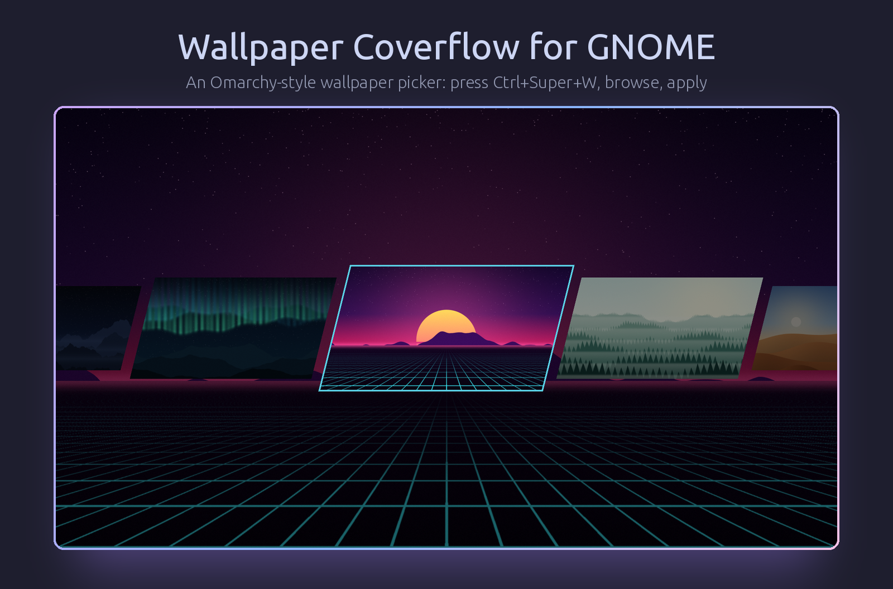
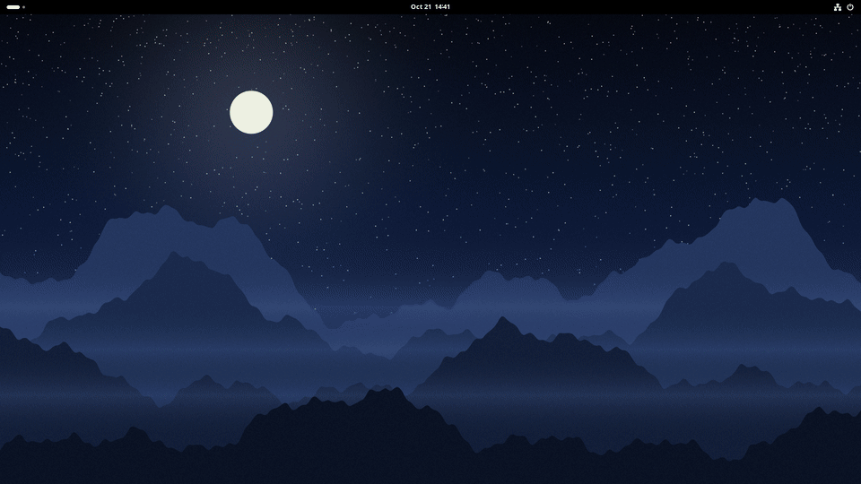

# Wallpaper Coverflow



Extension GNOME Shell đổi wallpaper bằng dải thẻ ảnh nghiêng toàn màn hình theo
kiểu Omarchy. Bấm phím tắt, duyệt các ảnh trong thư mục wallpaper, click ảnh để áp dụng.

Hỗ trợ **GNOME Shell 46–51**; đã test trên GNOME Shell 46 (Ubuntu 24.04, Wayland).

_English: [README.md](README.md)_

## Cách dùng

| Việc | Thao tác |
|---|---|
| Mở picker | `Ctrl+Super+W` (đổi được) |
| Duyệt ảnh | di chuột, `←` / `→` (hoặc `h` / `l`), cuộn chuột, `Home` / `End` |
| Áp dụng và đóng | click ảnh, hoặc `Enter` |
| Huỷ | `Esc`, hoặc click ra ngoài dải ảnh |



Mỗi lần hiện 5 ảnh dưới dạng thẻ 16:9 hình bình hành: ảnh đang chọn ở giữa, kích
thước đầy đủ và có viền sáng; hai ảnh mỗi bên nhỏ và tối dần theo khoảng cách, hai
ảnh ngoài cùng ló vào từ mép màn hình. Trỏ chuột vào ảnh bên cạnh sẽ đưa nó vào
giữa. Picker mở trên màn hình đang có con trỏ chuột, phủ lên bản làm tối của
wallpaper hiện tại. Ảnh được giải mã nền và chỉ cho các thẻ gần màn hình, nên thư
mục nhiều ảnh vẫn mượt.

Có thêm phím tắt tuỳ chọn **Next wallpaper** (mặc định tắt) để đổi sang ảnh kế
tiếp mà không mở picker.

Lựa chọn được ghi vào `org.gnome.desktop.background` (`picture-uri` và
`picture-uri-dark`), như đổi wallpaper trong GNOME Settings. Chế độ hiển thị hiện
tại (zoom, fill...) được giữ nguyên.

## Cài đặt

Từ [extensions.gnome.org](https://extensions.gnome.org) (sau khi được duyệt), hoặc
từ source:

```bash
git clone https://github.com/pvlamkhtn/gnome-wallpaper-coverflow
cd gnome-wallpaper-coverflow
./install.sh
```

`install.sh` đóng gói bằng `gnome-extensions pack`, cài cho user hiện tại và bật
extension. Trên Wayland, **đăng xuất rồi đăng nhập lại một lần** sau lần cài đầu.

Sau đó bỏ ảnh (`jpg`, `jpeg`, `png`, `gif`, `bmp`, `webp`) vào
`~/Pictures/Wallpapers`, hoặc chọn thư mục khác trong phần cài đặt.

## Cấu hình

Mở app *Extensions* → *Wallpaper Coverflow* → ⚙️, hoặc chạy
`gnome-extensions prefs wallpaper-coverflow@pvlamkhtn.github.io`.

| Cài đặt | Mặc định |
|---|---|
| Thư mục wallpaper (chỉ liệt kê ảnh nằm trực tiếp trong đó) | `Pictures/Wallpapers` |
| Mở picker | `Ctrl+Super+W` |
| Next wallpaper | tắt |
| Màu viền nổi bật | `#5AD1E6` |

## Gỡ cài đặt

```bash
./uninstall.sh
```

Xoá extension và settings của nó; ảnh và wallpaper hiện tại được giữ nguyên.

## Phát triển và đăng lên extensions.gnome.org

```bash
./preview.sh     # thử code trong repo bằng GNOME Shell lồng trong cửa sổ (không cần đăng xuất)
./preview.sh 2   # như trên, với hai màn hình cạnh nhau
```

Trên Wayland, shell đang chạy giữ nguyên code đã nạp lúc đăng nhập, nên thử code
mới bằng `install.sh` thì phải đăng xuất. `preview.sh` chạy một GNOME Shell riêng
trong cửa sổ, với cấu hình riêng, nạp extension thẳng từ repo; mở picker trong đó
bằng `Ctrl+Alt+W`. Session và wallpaper thật của bạn không bị đụng tới. Sửa code
xong thì đóng cửa sổ và chạy lại.

`./pack.sh` tạo `release/<uuid>.shell-extension.zip`. Quy trình đăng:
[docs/publish-extensions-gnome-org.vi.md](docs/publish-extensions-gnome-org.vi.md).

## Giấy phép

GPL-2.0-or-later, xem [LICENSE](LICENSE).
